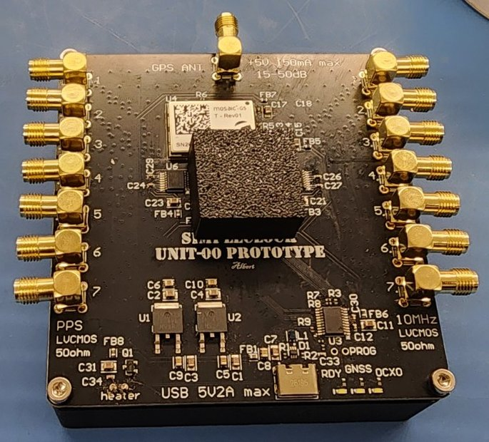
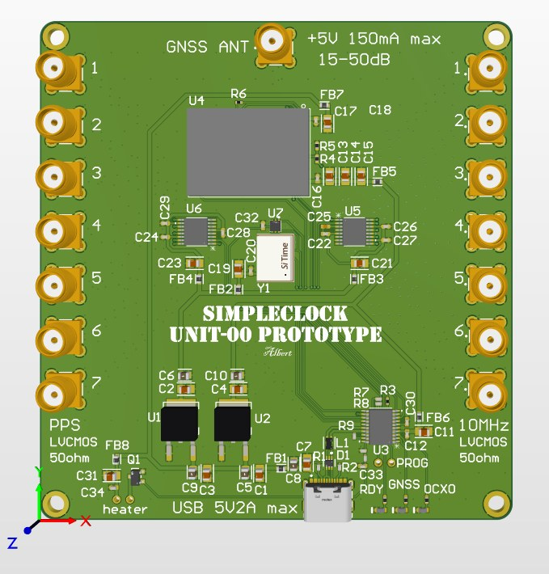
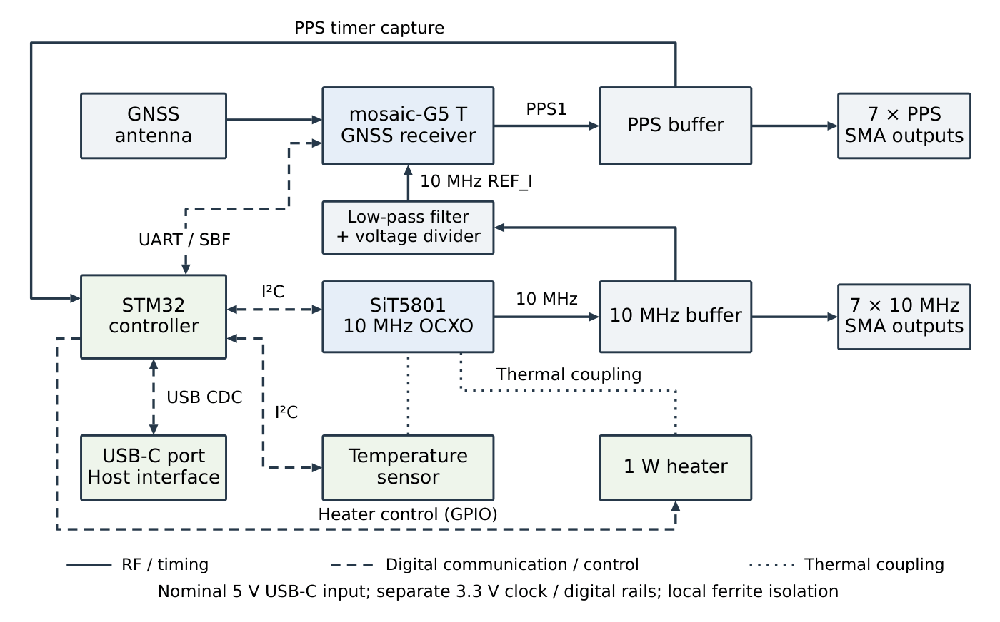

# SimpleClock

**An open-source, GNSS-disciplined 10 MHz and PPS reference for astronomical
instrumentation, built for about US$500.**

<!-- TODO: arXiv badge and link once the paper is announced. -->

<table>
  <tr>
    <td align="center" width="50%"></td>
    <td align="center" width="50%"></td>
  </tr>
  <tr>
    <td align="center">Assembled prototype (heater and aluminium block underneath)</td>
    <td align="center">Board revision 00</td>
  </tr>
</table>

SimpleClock combines a Septentrio **mosaic-G5 T** GNSS timing receiver, a
SiTime **SiT5801** digitally tunable MEMS oven-controlled oscillator (OCXO), an
external heater and an **STM32C071** microcontroller on one board. It was
developed as a station clock for low-frequency VLBI. It can also serve other
astronomical timing work, a laboratory or a distributed instrument.

It runs on its own from power-up. You only need a computer to program it,
change its settings or record its telemetry.

## At a glance

| | |
| --- | --- |
| **Outputs** | 7 × 10 MHz and 7 × PPS, SMA, LVCMOS into 50 Ω |
| **Oscillator** | SiT5801 10 MHz MEMS OCXO, I²C-tuned, 5 × 10⁻¹⁴ trim resolution |
| **GNSS solutions** | PPP with Galileo HAS, SBAS, standalone (rover or static position) |
| **Stability** (measured, PPP/HAS, open sky) | ADEV 3.5 × 10⁻¹³ and TDEV 134 ps at 1000 s; TDEV ≤ 143 ps from 1 to 50 000 s |
| **Thermal** | 1 W heater on an aluminium block, two-stage temperature control |
| **Power and control** | USB-C: 5 V input, serial telemetry and commands |
| **Antenna** | Active GNSS antenna, powered from the board; Galileo E6 needed for HAS |
| **Hardware cost** | About US$500 per prototype unit (estimate) |

## How it works

  

The OCXO is the clock of the whole board. It drives the 10 MHz outputs and
also the receiver's reference input, so the receiver's PPS is derived from the
same oscillator. Every second, the receiver reports how far its clock (the
OCXO) is from GNSS time (**bias**) and how fast it is running (**drift**). The
microcontroller uses these two numbers to steer the OCXO. No separate
time-interval counter is needed.

- **Frequency and phase loops.** A frequency-locked loop (FLL) acts on the
  drift; a proportional–integral phase loop acts on the bias. Each loop can be
  turned on or off, and each solution type (PPP/HAS, SBAS, standalone, static)
  has its own settings.
- **Changes of solution type.** If the receiver drops below the selected
  solution (for example from PPP to SBAS), only the frequency loop runs, so the
  output does not follow the bias step between solution types. Phase steering
  restarts once the selected solution is back and settled.
- **GNSS outages.** Short gaps (≤ 10 s) are bridged. During longer outages the
  oscillator holds its last trim.
- **Temperature.** A PID loop holds the board temperature beside the OCXO, and
  a slow outer loop moves the target to keep about half of the heater power in
  reserve.
- **Safety checks.** Receiver data are checked for framing, CRC, epoch and
  status, and stale or duplicate data are rejected before they reach the
  loops. Trim changes are rate-limited and bounded.

The [user manual](docs/README.md) describes the behaviour in detail;
[firmware/docs](firmware/docs/) covers the control design.

## Measured performance

Three units, A, B and C, ran side by side on a rooftop. A digitizer measured
the phase differences between their 10 MHz outputs, and the B–C pair was used
for the results. Each configuration was recorded for 200 000 s (55.6 h).
Equivalent single-unit stability (B–C pair ÷ √2):

| Configuration | Tf / Tphi (s) | ADEV at 1000 s | TDEV at 1000 s | Max TDEV, 1–50 000 s |
| --- | --- | --- | --- | --- |
| **PPP/HAS** | 0 / 10 | 3.5 × 10⁻¹³ | 134 ps | 143 ps at 1700 s |
| **Standalone, static position**, reduced satellite overlap | 10 / 100 | 4.1 × 10⁻¹³ | 115 ps | 268 ps at 8500 s |
| SBAS, reduced satellite overlap | 10 / 300 | 6.9 × 10⁻¹³ | 280 ps | 855 ps at 6600 s |
| PPP/HAS, reduced satellite overlap | 0 / 10 | 9.4 × 10⁻¹³ | 379 ps | 525 ps at 3200 s |
| Standalone rover, reduced satellite overlap | 10 / 300 | 1.0 × 10⁻¹² | 447 ps | 1090 ps at 5200 s |

Bold rows are the suggested setups: PPP/HAS under open sky, and a static
position where the sky is partly blocked. In "reduced satellite overlap" runs,
B and C used different satellites as a test. The figures show agreement
between co-located units, not absolute UTC accuracy; the method and details
are in the paper ([citation](#citation)).

## Getting started

1. **Build the board.** The schematic, Altium project, Gerbers, BOM and
   assembly notes are in [`hardware/`](hardware/).
2. **Program it.** Flash the firmware and upgrade the receiver: see
   [first flashing](docs/FIRST_FLASHING.md). Pre-built images are attached to
   each [release](https://github.com/awklau/SimpleClock/releases).
3. **Run it.** Connect the antenna and heater, power it over USB-C, and follow
   the [user manual](docs/README.md) for the LEDs, recording, loop settings
   and troubleshooting.

To build the firmware from source, see [firmware/](firmware/README.md). The
tools run on Windows, Linux and macOS.

## Repository

| Folder | Content |
| --- | --- |
| [`hardware/`](hardware/) | Schematic, Altium project, production files and BOM (CERN-OHL-S-2.0) |
| [`firmware/`](firmware/README.md) | STM32 firmware, host tests, flashing and recording tools (MIT) |
| [`docs/`](docs/) | [User manual](docs/README.md) and [first flashing](docs/FIRST_FLASHING.md) |

## Status

This is firmware release `0.0.0`, for board revision 00 (prototype). The
control and flashing procedures have been run on three boards. The hardware
procedures have so far been carried out on Windows.

The board's own telemetry and LEDs describe the clock as its receiver sees it.
They are not an independent measurement of output stability. See
[Measured performance](#measured-performance) for that.

## Citation

If you use SimpleClock, please cite:

<!-- TODO: arXiv identifier, then venue, year and DOI; keep CITATION.cff in step. -->
> A. W. K. Lau, B. Pollarolo and J. Mena-Parra, "SimpleClock: a
> satellite-disciplined oscillator for astronomical instrumentation",
> in preparation (arXiv link to follow).

GitHub's "Cite this repository" button uses [CITATION.cff](CITATION.cff).

## Licences

- Firmware and software: [MIT](LICENSE).
- Hardware design files: CERN Open Hardware Licence Version 2 – Strongly
  Reciprocal ([CERN-OHL-S-2.0](hardware/LICENSE)).
- Copyright © 2026 Albert Wai Kit Lau.
- Third-party sources under `firmware/vendor/` keep their own licences; see
  [firmware/vendor/README.md](firmware/vendor/README.md).

## Acknowledgements

SimpleClock was developed at the Dunlap Institute for Astronomy & Astrophysics,
University of Toronto, which funded the work.

## Trademarks

SiTime, Septentrio, mosaic, STMicroelectronics, STM32 and other product names
are trademarks of their respective owners. SimpleClock is not affiliated with
or endorsed by them; the names only identify the parts the board uses.
