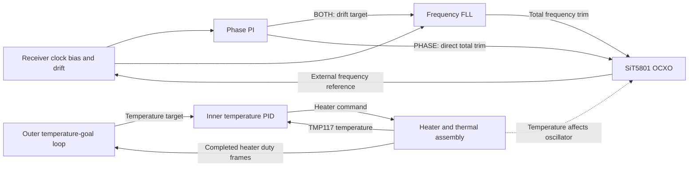

# Clock discipline

How the normal firmware steers the oscillator from the GNSS receiver's clock
estimates: control laws, qualification, limits and defaults. Values are
compiled defaults from `default_parameters.json` unless stated otherwise;
saved settings override the loop time constants. The temperature loops are in
[THERMAL_CONTROL](THERMAL_CONTROL.md).

## 1. How the four loops fit together

| Loop | Measurement | Controlled quantity | Output |
| --- | --- | --- | --- |
| Frequency FLL | Receiver-reported clock drift | Drift toward a requested value | Increment to OCXO total frequency trim |
| Phase PI | Filtered receiver bias relative to a local anchor | Relative clock phase | Drift target for the FLL, or direct OCXO trim in phase-only mode |
| Inner temperature PID | TMP117 temperature | Temperature toward a ramped target | External-heater duty |
| Outer temperature-goal integrator | Actual heater duty | Heater duty toward 50% | Slowly moving temperature target for the inner PID |

The two clock loops share one verified oscillator actuator. The thermal loops
form a separate cascade: the outer loop changes temperature goal, while the
inner loop drives the heater. Temperature also affects the physical oscillator;
there is no implemented temperature-to-frequency feed-forward model.

### Notation and units

| Symbol | Meaning | Unit |
| --- | --- | --- |
| $b_k$, $b_{ref}$ | Receiver bias and captured local bias anchor | ns |
| $e_k=b_k-b_{ref}$, $\bar e_k$ | Raw and filtered relative phase error | ns |
| $d_k$, $v_k$ | Reported drift and requested drift | ppb |
| $u_k$, $u^{app}_k$ | Unquantized total trim accumulator and verified applied trim | ppb |
| $T_f$, $T_\phi$ | Runtime frequency and phase time parameters | s |
| $\theta_k$, $\bar\theta_k$ | Raw and filtered temperature | °C |
| $r_k$, $r^{ramp}_k$ | Temperature goal and inner ramped goal | °C |
| $h_k$, $\bar h_k$ | Applied heater duty and its filtered value | Fraction, 0–1 |

Clock equations below use numerical ns and ppb values:
**1 ns/s is numerically 1 ppb**. SBF `RxClkBias` is converted from ms to ns;
`RxClkDrift` from ppm to ppb. Positive phase error requests a lower frequency.
Temperature differences in °C have the same numerical size as differences in K.
`clip(x,a,b)` means limit `x` to `[a,b]`.

Clock integration uses exactly **one nominal second per accepted receiver
epoch**. Epochs are normally exactly 1000 ms apart, with fresh arrivals; missing
epochs never produce a larger catch-up integration step. Thermal math uses
actual elapsed time between fresh updates, normally about one second.

**Short-gap bridge.** While tracking (FREQUENCY, PHASE_RECOVERING or TRACK), a
receiver gap of up to **10 s** (`clock.short_gap_bridge_s`) keeps steering
authority, the phase reference and the PI state: missing epochs (for example one
overwritten while an FCW write awaited readback, or an assembler drop) and
invalid fixes only hold the delivered trim. The next usable epoch continues
normally, with the clip prediction integrated over the whole gap; the
arrival interval must match the receiver interval within the usual 1.5 s slack.
`clock_guard` counts `bridged_gaps` and `bridged_epochs`. The receiver runs from
this OCXO, so its bias cannot step across such a gap without a flagged
reset/jump, which, like reference/configuration changes and source or time-system
changes after a gap, still recovers fully. A gap longer than the bridge (no
usable epoch for 11.5 s while tracking, 2.5 s otherwise) freezes to HOLDOVER as
before. Qualification and acquisition still require strictly contiguous epochs.

## 2. Frequency FLL

### Fine frequency control

Before envelope and slew limits, the implemented update is

$$
u^{trial}_{k+1}=u_k+A_k\frac{\Delta t}{T_f}(v_k-d_k),
\qquad \Delta t=1\ \mathrm{s}.
$$

The actuator gain is assumed to be **1 ppb of reported-drift change per ppb of
trim change**. Thus drift above the request reduces trim. `u` is total trim,
and `(v-d)/Tf` supplies its increment; `d` is the receiver's estimate rather
than an independent output-frequency measurement.

- In **FREQUENCY**, $v=0$.
- In **BOTH**, phase PI supplies $v$, bounded to **±0.1 ppb**.
- On frequency entry/re-entry, authority $A$ rises linearly from 0 to 1 over
  **60 s**, using MCU elapsed time. BOTH initially retains the entry drift
  request until phase qualifies; it need not immediately request zero drift.
- Fine control is constrained to **±1 ppb around the acquired trim**, intersected
  with the overall boot-relative envelope.

For illustration, at full authority, `Tf=100 s`, `v=0` and `d=+0.02 ppb`
request a trim increment of **−0.0002 ppb** for one accepted second, before limits.
`Tf` is a controller gain parameter, not a receiver averaging interval or a
guaranteed observed settling time.

### Cold acquisition and warm recovery

Every start, in every loop mode (BOTH, FREQUENCY and PHASE) and for every
source (PPP/HAS, SBAS, standalone), goes through this path. Cold startup
first needs GNSS qualification (thermal state is only a warning) for **strictly
more than 60 s** on both receiver and MCU arrival time. Its qualification fit
uses 61 points over 60 s; the latest **50 drift samples** form the acquisition
mean $\bar d$. The coarse target is

$$
u_{acq}=\operatorname{clip}(u^{app}-\bar d/g,\ u_{low},u_{high}),
\qquad g=1.
$$

It slews toward this target at at most **0.05 ppb/s**, then requires **50 wholly
new fixed-word samples** with $|\bar d|\le0.05$ ppb. Failed verification can
start another correction; after three acquisition attempts, further failure
latches `ACQUISITION_FAULT` until explicit resume. A warm restart checks
**5 qualified contiguous samples** and re-acquires only if their mean drift
exceeds 0.05 ppb (section 4).

**PHASE acquires frequency like the other modes, then holds the trim until its
phase span qualifies; it never runs the FLL. OFF runs neither loop.**

Sources: [hybrid.c](../core/src/hybrid.c), especially `acquire`,
`enter_frequency`, `track_request`, `control_sample` and `sc_hybrid_take_command`.

## 3. Phase PI

### Local reference and per-sample clip

Each accepted receiver bias first passes one bounded rule. With the previous
estimate $\hat b_{k-1}$ and trapezoidally integrated receiver drift,

$$
r_k=b_k-\hat b_{k-1}-\frac{d_k+d_{k-1}}{2}\Delta t,\qquad
\hat b_k=\hat b_{k-1}+\frac{d_k+d_{k-1}}{2}\Delta t+\operatorname{clip}(r_k,-c,+c),
$$

with clip $c$ = **2 ns** by default (`hybrid clip <1..5000>`, in ps). Normal
noise passes unchanged; an outlier moves the estimate by at most $c$; a
persistent shift passes at $c$ ns per second; noise much larger than $c$
becomes a low-pass whose time constant grows with the noise. There is no
rejection, holdover or step state. The raw innovation and a clipped-sample
count are reported in `clock_guard`; the raw sample starting a clipped stretch
is latched in `clock_failure`. A receiver-domain handover offset is not clipped.

The first phase activation captures $b_{ref}=\hat b_k$ if no valid anchor
exists. Subsequent control uses

$$
e_k=\hat b_k-b_{ref},\qquad \bar e_k=e_k.
$$

There is **no measurement filter**: $\bar e_k$ (`filtered_error`) keeps its name
for lock checks and telemetry but equals $e_k$. The previous fixed 10 s filter
produced a 15–25 s ADEV/TDEV bump at short Tphi in analysis, and the clip
already bounds outliers. The
error is 0 at each phase activation (fresh reference). Cold/recovery phase entry ends
that sample without PI integration or an actuator update; an ordinary active
handover can still make its normal bounded FLL update.

The phase target is **relative receiver bias**. It is not calibrated UTC/PPS
phase alignment, and does not establish a measured phase offset at the output
connector; the receiver bias it holds is an arbitrary offset from GNSS
time fixed at first activation (`absolute_aligned=0`).

**Every restart of phase control takes a fresh reference** (resume, GNSS-outage
longer than the short-gap bridge, actuator-fault recovery, phase re-enabled
after FREQUENCY-only operation).
The phase error accumulated during holdover is left in place as a logged clock
break instead of being steered back: `phase_reanchor` reports each step (new
minus old reference) and `clock_guard` reports the count and running total, so
the offset history can be reconstructed and applied in analysis. Steering it
back pulled the oscillator up to about 1.1 ppb for ~25 min in the model (300 s
hold with a 1 ppb move); re-anchoring re-locked in 158 s with no pull. A usable
solution/time-system handover also captures a new anchor (not counted as a
restart). Reset/jump/reference/configuration discontinuities force reference
recovery.

### Gains and output in BOTH versus PHASE

For positive `Tphi`, the gains are coupled:

$$
K_{p\phi}=\frac{2}{T_\phi},\qquad
K_{i\phi}=\frac{1}{T_\phi^2},\qquad
I^{trial}_{k+1}=I_k-K_{i\phi}\bar e_k\Delta t.
$$

With ns/s interpreted as ppb, $K_p$ has units s⁻¹ and $K_i$ s⁻².
Increasing `Tphi` tenfold reduces proportional gain tenfold and integral gain
one hundredfold. Independent P and I adjustment is not exposed.

**BOTH — phase PI requests drift, then FLL changes trim:**

$$
v^{raw}_{k+1}=I^{trial}_{k+1}-K_{p\phi}\bar e_k,
\qquad v_{k+1}=\operatorname{clip}(v^{raw}_{k+1},-0.1,+0.1)\ \mathrm{ppb}.
$$

The FLL then uses this request in section 2. The phase integral's physical
meaning here is a **drift request**, in ppb.

**PHASE — phase PI directly requests total oscillator trim:**

$$
u^{raw}_{k+1}=I^{trial}_{k+1}-K_{p\phi}\bar e_k.
$$

Here the integral represents **total trim**, in ppb. The output uses the
boot-relative ±10 ppb envelope and normal trim slew limit; it does not use
BOTH's ±0.1 ppb drift-request clamp or the FLL's acquired-trim ±1 ppb span.
Receiver drift still serves integrity checks and diagnostics.

At activation and active gain changes, the PI is preloaded for output continuity:

$$
I=\text{previous output}+\frac{2}{T_\phi}\bar e.
$$

The previous output is the drift request in BOTH and the trim accumulator in
PHASE. Mode changes remap these meanings instead of copying the integral
unchanged. Accepted live profile edits retain delivered trim, fractional state,
history and anchor; editing an inactive profile does not retune the active PI.

### Phase qualification and relative lock

Cold/recovery phase permission needs **121 contiguous good samples spanning at
least 120 s** and the following 121-point fit checks:

- Drift standard deviation ≤ **0.1 ppb**.
- Bias-minus-integrated-drift residual slope magnitude ≤ **0.03 ppb**.
- Detrended residual RMS ≤ **5 ns**.

The residual is accumulated using trapezoidal drift integration:

$$
R_k=R_{k-1}+(b_k-b_{k-1})-
\frac{d_k+d_{k-1}}{2}\Delta t.
$$

Fitted slope uses ordinary least squares over equally spaced accepted epochs:
$\hat m_y=\sum(t_i-\bar t)(y_i-\bar y)/\sum(t_i-\bar t)^2$.
For bias or residual in ns, slope in ns/s is reported in ppb.

`relative_lock=1` additionally requires a full same-domain phase span,
filtered phase error within **±5 ns**, a **101-point/100 s bias slope within
±0.02 ppb**, and no hard limit (envelope, tracking span or drift-setpoint
clamp; the per-sample slew cap is not counted, since at short Tphi it trims
measurement noise on most samples and a cap that starves the loop fails the
phase and slope checks), continuously for **10 s** on MCU and
receiver clocks. Lock clears after failed conditions persist for **3 s**
(`lock_bad_dwell_s`); the failing conditions are reported as `lock_failures`.
Temperature is not a clock qualification or lock condition (see section 4).

`PHASE_RECOVERING` describes unmet lock qualification; **phase steering may
remain enabled**. Small phase error alone is insufficient to establish lock.
A contiguous qualified PPP/SBAS/standalone or time-system handover can retain
active steering, re-anchor local phase and restart its 120 s lock span.

### Limiting and anti-windup

The controller trials $\Delta I=-\bar e\Delta t/T_\phi^2$, applies limits,
and skips only an integral step that would push farther into an active limit:
direct PHASE uses $(u^{raw}-u^{limited})\Delta I>0$; BOTH checks its
drift-request clamp and downstream FLL limiting. **The limited command is still
sent.** Recomputing the output from the held integral (the old rule) repeated
the preloaded output and stalled a retained error. Back-calculating the integral
from the limited output (projection) fed proportional-path and measured-drift
noise into it and limit-cycled under the slew cap (analysis model: PPP Tphi
10 s TDEV(100 s) 36 → 142–808 ps with 0.05–1 ns extra noise; standalone BOTH
114 → 289 ps). Unwinding is always permitted. Regression:
`tests/test_hybrid_robust.c`.

Sources: [hybrid.c](../core/src/hybrid.c), `activate_phase`,
`preload_phase_pi`, `enter_phase`, `track`, `phase_status` and `handover_phase`;
[hybrid_stats.c](../core/src/hybrid_stats.c).

## 4. Limits, validity and settings

The overall trim envelope is the intersection of hardware clipping and **±10
ppb around the first valid boot readback**. Normal fine-control slew is **0.003
ppb/s**. Each proposal's maximum movement is
$0.003\min(1,\text{seconds since last completed write})$ ppb: accumulated
wall time cannot create a large step. Hitting an absolute/tracking envelope
freezes steering for recovery; ordinary slew limiting can leave steering active
while revoking relative lock.

Trim is rounded to signed 39-bit FCW using the implemented codec:

$$
q=\operatorname{round}_{\text{ties away from zero}}
\left(u\frac{2^{38}-1}{800000}\right),\qquad
u^{app}=q\frac{800000}{2^{38}-1}\ \mathrm{ppb}.
$$

One FCW count is about **2.91038×10⁻⁶ ppb**. Sub-FCW corrections remain in the
double-precision accumulator; a quantized no-op does not discard them. A bus
write is not proof of applied trim: independent readback must match. Invalid,
mismatched or stale actuator evidence enters `ACTUATOR_UNKNOWN`; recovery
after loss needs two consistent valid probes. No further proposal is issued
while a write awaits verification.

Clock control additionally requires qualified receiver configuration, fresh
complete numeric epochs/status, successful RAIM, clear RF/error status, external
frequency present and receiver internal steering off. PPP/HAS needs actual
mode 10, Galileo time, orbit/clock corrections in use and correction age ≤30 s.
Actual mode 6 selects SBAS; standalone mode 1 or verified settled Static mode 3
selects standalone. SBAS requires an available correction age but has no
separate numeric age-expiry gate here. Satellite count is diagnostic.

Thermal and clock control are independent services. Thermal conditions are
**warnings** (LED3 blinking, `thermal_warning` entry/clear records and the
`thermal_warning` bits in `clock_guard`): sensor invalid/unsafe (1), thermal
startup (2), regulation (4: LED3's own verdict, raw error beyond **0.25 K** or
error slope beyond **0.1 K/min**), and valid 30 s duty mean outside **2–98%** (8).
The adapter derives them from the heater snapshot only; the clock controller
has no thermal inputs or temperature statistics at all. None of them stops
eligible clock acquisition, steering, handover or lock. An
invalid sensor or overtemperature still protects the heater; invalid GNSS still
prevents GNSS steering; an unknown actuator still prevents trim writes.
Temperature SD/peak-to-peak are logged only.

Integrity checks include drift innovation
$d_k-d_{k-1}-(u^{app}_k-u^{app}_{k-1})$ within **±0.25 ppb**; the bias
innovation is clipped as described in section 3, not rejected. A single
rejected drift sample while tracking is skipped (the next epoch is a bridged
gap); two consecutive rejections freeze. Invalid/stale data holds the trim
without integrating across the gap, and freezes once it outlasts the short-gap
bridge; inner heating continues if safe.

### Profiles and operator readback

| Actual eligible source | Compiled `Tf` | Compiled `Tphi` |
| --- | --- | --- |
| PPP/HAS | 0 (PHASE only) | 10 s |
| SBAS | 10 s | 100 s |
| Standalone (rover) | 10 s | 100 s |
| Static PVT fixed position | 10 s | 100 s |

These pairs come from bench measurements (300 s SBAS/standalone pairs were
worse in replays, because receiver measurements degrade when OCXO and GNSS
diverge). The static pair starts at the same 10/100 s as SBAS and standalone.

PPP with few satellites (for example 5-6) is left as is: the receiver keeps a
noisier PPP solution and the firmware steers it with the PPP pair. There is no
receiver setting for a minimum satellite count (mosaic-G5 v1.1.0 reference
guide; `setSolutionSelectivity` has no satellite threshold), and slower gains
or TDOP scaling would still not use the best available solution and would need
calibration. A site that repeatedly sees only ~6 satellites should be switched
manually to another mode (`gnss sbas`/`gnss standalone`, or Static PVT).

**Every start acquires frequency first, in every mode.** A cold start always runs
qualification, coarse acquisition (0.05 ppb/s) and 50-sample verification. A
restart (`hybrid resume`, GNSS-outage or actuator-fault recovery) runs the
5-sample warm qualification and re-acquires when its drift mean exceeds
**0.05 ppb**. Only then does the fine loop take over; for PHASE, the trim is held
until the phase span qualifies. Without this, a PHASE Tphi 10 s loop could not
pull in a multi-ppb cold offset under the 0.003 ppb/s slew cap (model: a freeze/
requalify loop, or a ±1.8 ppb ~2700 s limit cycle). Regression model: every
source locks from a 2 ppb cold offset in about 235 s (`test_hybrid_robust.c`).

Each time is independently **0 (disabled), or 10–86400 whole seconds**:

| `Tf` | `Tphi` | Derived `loop_mode` |
| --- | --- | --- |
| Positive | Positive | BOTH |
| Positive | 0 | FREQUENCY |
| 0 | Positive | PHASE |
| 0 | 0 | OFF |

**`Tphi >= 2.5 * Tf` is tuning advice only when BOTH is used.** There is no ratio
validation or save constraint; an inner FLL slower than the phase loop (for
example Tf 60 s with Tphi 10 s) is poorly damped. The 1 Hz sampling, actuator
limits and real plant still affect stability and realized response; acceptance
of a pair is not a performance qualification.

Use `hybrid config` to read all eight loop times, the clip and the PPS policy
(`hybrid_config v=4`). Change a pair with
`hybrid params ppp|sbas|standalone|static <Tf> <Tphi>`, the clip with `hybrid clip
<1..5000>` (ps) and the receiver PPS policy
with `pps policy continuous|qualified|off|manual`; `hybrid save` explicitly
persists them all (settings record v5). Saved settings override compiled defaults. The current parser
rejects the historical `hybrid mode ...` and `hybrid params fallback ...` forms.
Live pair edits need no hold; pending actuator work/manual trials can reject
them. Require the matching command acceptance and config readback.

`hybrid hold/resume` freezes/requalifies clock control only; resume does not
require thermal health. `outer pause/resume` explicitly pauses/unpauses outer
permission. `outer gain <1..20>` changes $G_\theta$ in K/unit duty only while
the outer loop is explicitly paused. `thermal pi <target_C> [duration_s]` starts inner regulation; the normal
profile still uses PID. `thermal off` stops heating. Holds, trim/integrals,
phase anchors and thermal/outer overrides are volatile.

Useful telemetry: `clock_auto` for phase authority/reference/error and lock;
`clock_actuator` for requested/applied trim and limiting; `clock_guard` for
clipping, raw innovation, integrator limiting, lock failures and thermal
warnings; `clock_failure` for the latched trigger sample; `thermal_warning` for
warning entry/clear; `gnss_dop` for passive TDOP; `gnss_pps` for PPS policy
readback; `hybrid_quality` for windows/integrity; `thermal_pi` for inner P/I/D and ramp; `thermal_outer` for
goal, actual duty and permissions. Clock `*_ps` values divide by 1000 to give
ns; `*_nppb` divide by 10⁹ to give ppb; PID `*_micro` divide by 10⁶ to give duty.
Frequency-settled indication is a separate observer of receiver-reported drift,
not another actuator loop or an independent ADEV measurement.

For exact commands and telemetry see [COMMANDS](COMMANDS.md). Parameter provenance is
[default_parameters.json](../default_parameters.json), compiled into
[hybrid_defaults.h](../core/include/simpleclock/hybrid_defaults.h).
Input eligibility is implemented in [hybrid_input.c](../core/src/hybrid_input.c);
FCW conversion in [sit5801.c](../core/src/sit5801.c).

The equations describe the implemented control laws under the nominal-operation
assumption; they are not measured output-clock performance results.

## 5. Timing summary

| Stage | Duration / rate | Key parameters |
| --- | --- | --- |
| Qualify (cold) | > 60 s | Usable GNSS solution; receiver data older than 2.5 s means holdover |
| Short-gap bridge | Up to 10 s | While tracking, missing epochs or invalid fixes hold the trim but keep authority and reference; holdover after 11.5 s without a usable epoch (2.5 s when not tracking) |
| Acquire | 50-sample average | Slew 0.05 ppb/s; up to 3 attempts |
| Verify | 50 samples | Residual mean ≤ 0.05 ppb |
| Warm restart | 5-sample check | Re-acquire if mean drift > 0.05 ppb; 60 s authority ramp; fresh phase reference, logged in `phase_reanchor` |
| Phase activation and lock | 120 s qualification | Lock after 10 s good, lost after 3 s bad; 100 s lock-statistics window |
| Phase PI | 1 Hz | Kp = 2/Tphi, Ki = 1/Tphi² |
| Input guard | Per sample | Bias innovation clipped to ±2 ns; frequency innovation limit 0.25 ppb |
| Oscillator actuator | ≤ 1 write/s | Tracking slew 0.003 ppb/s; ±1 ppb about the acquired trim, within ±10 ppb of the boot readback; ≥ 50 ms between register reads |
| LED1 frequency settled | 50 samples + 10 s good | 121-sample scatter window; 120 s holdover grace |

In simulation, a cold start locks in about 235 s for every source and a
restart relocks in about 158 s; these are model results, not hardware
measurements.
